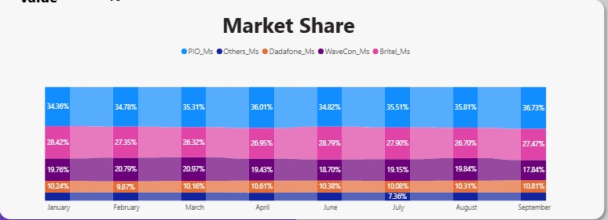

# Wavecon Telecom: 5G Launch Performance Analysis

**Narmatha Annadurai · Codebasics Virtual Internship · Week 2, Task 4**

I reviewed a supplied Power BI dashboard to understand how Wavecon performed before and after its 5G launch. I compared company results, customer metrics, market share, cities and recharge plans, then prepared a 10-slide stakeholder presentation and recorded my explanation.

## Business problem

Wavecon wants to understand how its business changed after launching 5G, which customer metrics need attention, and which recharge plans should grow, change or stop. The assignment includes five starting questions about revenue, customer KPIs, plan performance and discontinued plans. I also examined city results and competitor market share.

## Scope and tools

- **Before 5G:** January-April 2022
- **After 5G:** June-September 2022
- **Coverage:** 15 cities, with four months in each period. May is excluded.
- **Tools:** Power BI dashboard review, DAX measure inspection and comparison calculations.
- **Project type:** Analysis of a supplied dashboard. I did not build the original dashboard.

## Main findings

| Measure | Before | After | Change |
| --- | ---: | ---: | ---: |
| Revenue (INR million) | 15,977.0 | 15,896.6 | -80.4 million / -0.50% |
| Sum of monthly active-user counts | About 84.4 million | About 77.4 million | -8.28% |
| Sum of monthly unsubscribed-user counts | About 5.633 million | About 6.957 million | +23.50% |
| Reported average revenue per user | INR 190.23 | INR 211.25 | +11.05% |
| Wavecon average monthly market share | 20.24% | 18.88% | About -1.36 percentage points |

Percentage changes use the underlying dashboard values where captured. Displayed starting and ending values may be rounded.

### City findings

Delhi lost about INR 56 million and Chennai about INR 39 million. Their combined loss of about INR 95 million exceeded the company's net loss because revenue gains in other cities reduced the overall decline.

Pune's active users grew 18.06%, while ARPU fell 12.88%. Lucknow's unsubscribed-user counts rose 77.91%. These patterns need different follow-up checks. Lower-priced plan choices in Pune are a possible explanation to investigate, not a confirmed cause.

### Plan findings

P1 revenue grew about 31.66%, from approximately INR 1,813 million to INR 2,387 million. P7 fell about 73.24%, from approximately INR 583 million to INR 156 million, the steepest decline among continuing plans.

New plans P11-P13 generated approximately INR 3,336 million after the launch. This may include users moving from existing plans. P8-P10 have no post-launch values shown. Their retirement status and reason need confirmation from company records.

## Recommendations

1. Investigate revenue losses in Delhi and Chennai, lower revenue per user in Pune and increased unsubscribed-user counts in Lucknow.
2. Assess whether P1 can grow profitably. Review P7 demand and margins before changing the offer, moving customers to another plan or stopping it.
3. Confirm the status of P8-P10 before making a firm statement about why they stopped.

## Evidence and interpretation

- Headline revenue sums the Wavecon metrics fact table. Plan revenue sums a separate plan revenue fact table. Their totals differ, and the business scope has not been reconciled.
- The ARPU measure averages the source ARPU records. It is not calculated here by dividing total revenue by a distinct user count.
- Active and unsubscribed-user totals add monthly counts. They do not represent distinct people across the four-month period. Unsubscribed-user growth is not a churn rate.
- Market share compares simple averages of the displayed monthly shares. It is not a verified weighted market share for the whole period.
- Plan and city amounts are approximate where calculated from rounded dashboard values. Blank plan cells do not prove zero activity.
- Before-and-after changes do not establish that 5G caused the changes. Profit, migration and customer feedback would be needed to confirm explanations and final plan decisions.

## Files

- [Monthly revenue calculations](monthly-revenue.csv)
- [Market share comparison](market-share-comparison.csv)
- [Plan comparison](plan-comparison.csv)
- [Market dashboard](market-dashboard.png)
- [Market share visual](market-share-chart.png)

[View the 10-slide stakeholder presentation (PDF)](Wavecon_5G_Presentation.pdf)

## Data source

Wavecon dashboard supplied for Codebasics Virtual Internship, Week 2, Task 4. This is an educational case study. Source dashboard and course materials belong to their respective owners.

## Presentation recording

[Watch the stakeholder presentation](https://drive.google.com/file/d/19gUbjtMsyoYJvnFX6w6Tm7A0lqiipRFj/view?usp=sharing)
